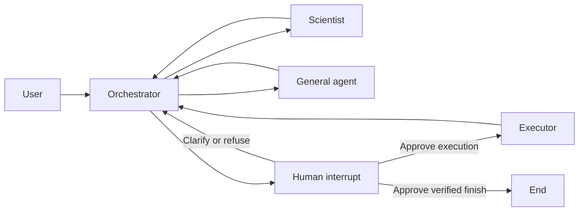

# Silverbox Agentic System

A four-role agent workflow built with LangGraph and a local Ollama language
model. The system plans, implements, runs, and evaluates a neural dynamics model
for the Silverbox oscillator, preserving the full conversation and execution
evidence.

## Previous Homework 1 validation

The measurements below come from the earlier workflow. Homework 2 demonstrations
are recorded separately in the local run folders and Task 1 report.

The recorded study trained four models from scratch and independently reloaded
all checkpoints to verify the reported continuous free-run predictions.

| Measurement | Result |
|---|---:|
| Training RMSE | 26.62 mV |
| Test RMSE | 38.96 mV |
| Zero-prediction test baseline | 60.49 mV |
| Successful script execution | 27.5 seconds |
| Full agent workflow | 303.2 seconds |

The latest validation completed without interruption in five orchestrator
decisions and nine model calls. One generated script trained the four models;
the workflow also requested a scientist review before its finish decision.

The selected network has hidden widths `[32, 32]`, Adam with learning rate
`0.001`, 700 updates, 20-sample training windows, and batch size 1.
This is a small architecture/configuration study; the test record also serves
for model selection. Training window MSE and full-record free-run RMSE measure
different behavior.

The report and raw validation evidence remain in the local project under
`output/`. This public repository contains source code only.

## Architecture



| Role | Responsibility | Coding tool |
|---|---|---|
| Orchestrator | Model-selected next role, instruction, and reason | No |
| Scientist | Equations, network, training, evaluation, and implementation plan | No |
| General agent | Explain concepts and reported measurements | No |
| Executor | Generate a new Python script, run it, and handle tracebacks | Yes |

Every node reads the shared dialogue and appends a message containing its role
and text. The orchestrator makes a fresh model call for each routing decision.
Routes are not selected by keywords or a fixed sequence of roles.
The model also chooses when to ask a human. Clarification adds the actual reply
to the shared dialogue without granting permission. Approval identifies a concrete
executor or finish action. Reply `yes`, `y`, `approve`, or `accept` to authorize
that action once; other replies grant no permission and return to the orchestrator.
The human and finish nodes are control steps; there are still four model agents.
The native JSON schema separates ordinary routes from human questions and makes
the proposed action mandatory for approval. Invalid model decisions receive at
most two corrective retries; Python does not select a replacement route.
After successful verification, the orchestrator also receives a short reminder
of the checked score after the full transcript, helping it recognize completed
work without repeating a fit merely to print the same measurement.

## Installation

Use Python 3.12 and install [Ollama](https://ollama.com). Place your Silverbox
benchmark file `SNLS80mV.mat` in `silverbox/data/` (create that folder if needed).
The benchmark data and local execution records are not included in this public
source distribution. From this repository's root:

```sh
python3.12 -m venv .venv
.venv/bin/python -m pip install -r requirements.txt
ollama pull qwen2.5:7b
ollama pull qwen2.5-coder:7b
```

Start Ollama if it is not already running. The default endpoint is
`http://localhost:11434`.

## Run the system

```sh
.venv/bin/python run.py
```

When the graph pauses, the terminal shows the human question and, for approval,
the action description and exact instruction. Type your actual reply. Closing
input leaves status `waiting_for_human`; resume the same run folder to answer later.

The default user request is the Silverbox modeling problem. Another request can
be supplied with `--request-file path/to/request.txt`. Use `--model` or
`--base-url` to change the Ollama model or endpoint. The executor uses
`qwen2.5-coder:7b`; change it with `--executor-model`. Other roles use `qwen2.5:7b`.

Each run writes a timestamped folder under `output/runs/`. Inspect
`output/latest_run.json` for the completion status and verified measurements.
`output/latest_completed_run.json` preserves the last successful result even if
a later run fails or is interrupted; the report builder uses that successful run.
Model calls can take several minutes on a laptop; the 300-second limit applies
to each generated Python script, separately from language-model generation.

Press Ctrl+C to stop. The runner records an `interrupted` status and, if a Python
script is executing, terminates and reaps its process group. Its stdout and stderr
are written directly to the attempt files, so output is available during execution
and after an interruption. SIGTERM follows the same cleanup path.

Resume using the saved folder's name:

```sh
.venv/bin/python run.py --resume-run <run-folder-name>
```

The saved dialogue, scientist plan, decision count, and model/endpoint choices
are retained. Explicit CLI model or endpoint options override saved choices.
A pending selected specialist runs first, including one selected by decision
eight; the eight-decision budget does not reset. A completed run or an exhausted
run with no pending specialist cannot resume. A process lock prevents two
sessions from resuming the same run simultaneously.

The runner compiles with `SqliteSaver`, using `checkpoints.sqlite` for native graph
state and the run folder name as `thread_id`. It resumes a paused question with
`Command(resume=reply)` on that same thread. JSON files remain atomic exports and
store model/session metadata; earlier JSON-only runs can also be imported.
Unfinished model calls can retry. Before invoking the coding tool, the executor
durably consumes the approval. If execution is interrupted or crashes, that
approval cannot run the step again: the orchestrator must request fresh permission.

### Coding tool and completion rules

Only the executor node has `write_and_run_python`. Its model returns structured
`filename` and `code` arguments, which the node passes to the tool. It writes a new file
in an attempt directory, runs Python, and returns the actual exit code, stdout,
stderr, timeout status, and elapsed time. A failed script can be repaired on a
later executor turn without changing the scientist's plan.

- Each generated script has a 300-second timeout; its process group is terminated on timeout.
- The orchestrator makes at most eight decisions, including a finish decision.
- Every execution/repair requires approval of that specific action.
- Finish requires both human approval and independently verified test RMSE.
- Claimed numbers in model prose do not authorize finish.
- Hitting the decision limit is reported separately from successful completion.

The tool runs generated Python with the launching user's permissions.
Working-directory isolation organizes artifacts; it is not an OS security sandbox.

## Silverbox validation

The scientist chooses two architectures and two training configurations per
architecture within runtime bounds, giving four fits. Both configurations vary
optimizer, learning rate, update count, and rollout length. The executor trains
each model from scratch using the bundled PyTorch/RK4 primitives under `silverbox/`.
The generated driver supplies the scientist's architectures and settings to
`study_utils.run_study`. That helper runs every combination and handles checkpoints,
selection, prediction export, plotting, and printed metrics consistently.

The data protocol uses `SNLS80mV.mat`, slice `[42650:46746]`, full-excerpt mean
centering, and a chronological 3,072/1,024 training/test split. Network RMS scales
use training data. Evaluation integrates all 4,096 samples continuously, carrying
the state across the split without measured-test-output corrections.

The selected model has the lowest test RMSE. This test record therefore also
serves for model selection. The checker reloads all four new checkpoints,
recomputes their scores, verifies the planned configurations and best-model
selection, and compares the saved prediction trace with the recomputed trajectory.

## Recorded artifacts

| Artifact | Contents |
|---|---|
| `dialogue.json`, `dialogue.md` | Shared conversation and role-tagged turns |
| `model_calls.jsonl` | Actual model prompts, responses, and timings |
| `graph.mmd` | Mermaid representation of the compiled graph |
| `attempt_*/` | Generated script, stdout, stderr, and execution evidence |
| `results.json`, `*.pt` | Comparison configurations and fresh checkpoints |
| `predictions.csv`, `test_predictions.png` | Full trace and test comparison |
| `summary.json` | Completion status, decisions, time, and verified result |
| `checkpoints.sqlite` | Native graph checkpoints and pending human interrupts |
| `checkpoint.json` | Atomic state export and model/session metadata |
| `consumed_approvals/` | Single-use execution approvals, preventing crash replay |

Recorded process paths identify the machine where validation ran. The report
builder rebases artifact locations to the current repository directory.

## Verification and report

```sh
.venv/bin/python -m unittest discover -s tests -v
.venv/bin/python -m pip install -r requirements-report.txt
.venv/bin/python build_task1_report.py --clarification-run <clarification-folder> --approval-run <approval-folder> --test-count 34 --repository-url <task1-source-url>
```

The Task 1 report builder reads the two explicitly selected real runs and writes
`output/pdf/homework2_task1_report.pdf` plus `output/task1_report.md`. It requires
actual human replies, refusal evidence, acceptance, and verified execution; it never
fills missing answers with examples. The older `build_report.py` remains the
Homework 1 Task 6 report builder.
Tests include real child-process interruption, timeout cleanup, checkpoint write
failure, concurrent-run exclusion, and resuming a pending eighth specialist turn.
Human-interrupt tests cover refusal without execution, acceptance once, clarification,
changed-action rejection, SQLite reopen, and runner restart without duplicate replies.

## Source map

| File | Purpose |
|---|---|
| `state.py` | Dialogue reducer and shared state |
| `schemas.py` | Routing-decision and scientific-plan validation |
| `prompts.py` | Role instructions and the user problem |
| `agents.py` | Four role nodes and real model-call logging |
| `graph.py` | StateGraph connections and termination guards |
| `human.py` | Native human interrupts and specific, single-use approval |
| `coding_tool.py` | Write/run tool with process timeout handling |
| `verification.py` | Independent checkpoint and trajectory checks |
| `run.py` | Run entry point and transcript persistence |
| `persistence.py` | Atomic JSON checkpoints, legacy loading, and exclusive run locks |
| `build_report.py` | Written report from actual execution artifacts |
| `build_task1_report.py` | Homework 2 Task 1 report from two real interactive runs |
| `silverbox/` | Tested neural dynamics primitives and benchmark data |
| `silverbox/src/study_utils.py` | Execute the chosen study and save benchmark artifacts |

The scientific support code comes from the
[Silverbox neural dynamics project](https://github.com/WhoEvenAm/Physics-Informed-Neural-Network-for-the-Silverbox-oscillator).
Framework references: [LangGraph StateGraph](https://docs.langchain.com/oss/python/langgraph/graph-api),
[ChatOllama](https://docs.langchain.com/oss/python/integrations/chat/ollama), and
[Ollama structured outputs](https://docs.ollama.com/capabilities/structured-outputs).
